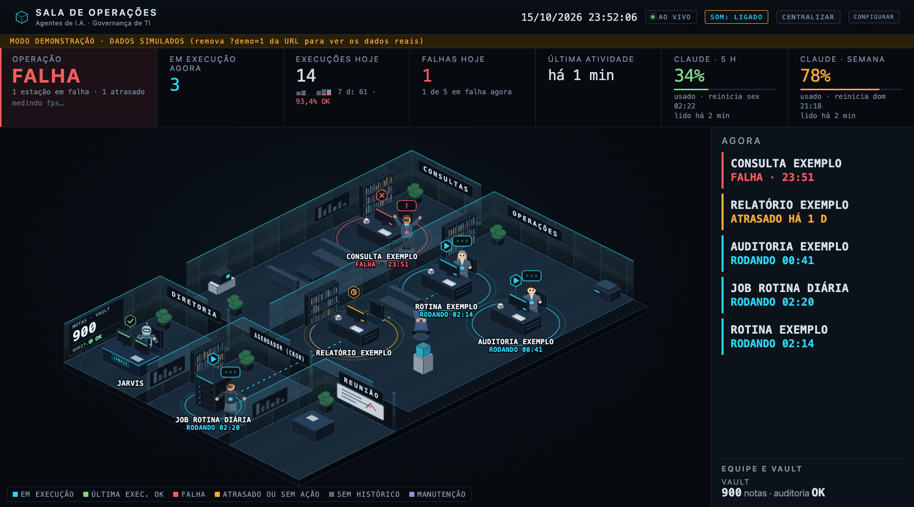
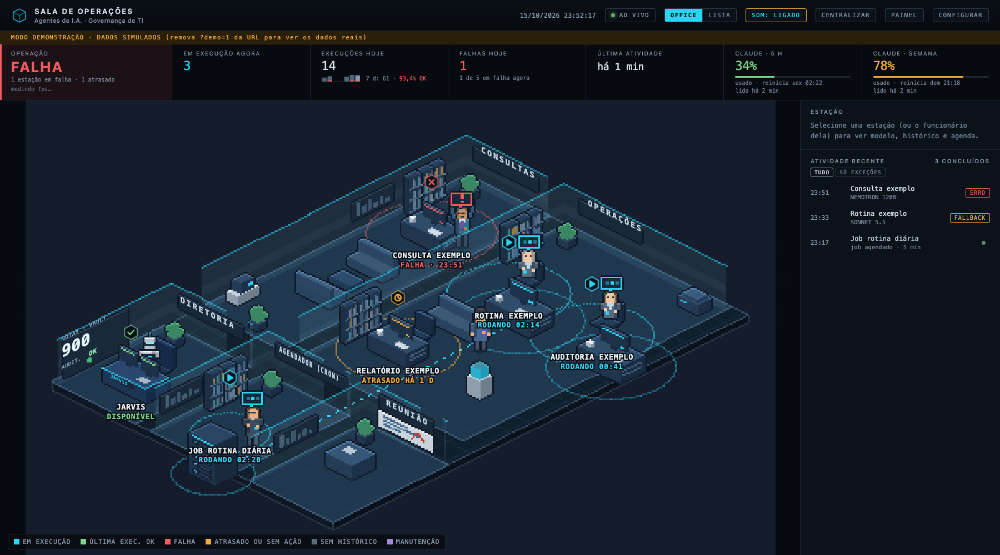

# Sala de Operações

🇧🇷 [Português](README.md) · 🇺🇸 **English**

**Watch your AI agents at work.** Sala de Operações ("Operations Room") turns agents, scheduled jobs and your team's ticket queue into a living office where every agent is an employee with a desk of their own. Whoever is running sits down and types. Whoever failed stands up and asks for help. One look tells you how the operation is doing, with no logs and no terminal. It works with **Hermes** and with **Claude Code**.


<sub>All screenshots use demo mode, with fictitious agents and numbers. The interface is currently in Brazilian Portuguese.</sub>

## Contents

- [Four ways to see the same operation](#four-ways-to-see-the-same-operation)
  - [Floor plan](#floor-plan-the-day-to-day) · [TV mode](#tv-mode-for-the-wall-of-the-room) · [3D](#3d-the-same-room-with-depth) · [Pixel art](#pixel-art-the-same-room-game-style)
- [What you see at a glance](#what-you-see-at-a-glance)
- [Highlights](#highlights)
- [Requirements](#requirements)
- [Up and running in a minute](#up-and-running-in-a-minute)
- [With Claude Code](#with-claude-code)
- [Make it yours](#make-it-yours)
- [Privacy and security](#privacy-and-security)
- [Quality](#quality)
- [Built with](#built-with)
- [License](#license)

---

## Four ways to see the same operation

### Floor plan: the day-to-day
The full view for whoever follows things closely. Each room groups one kind of agent, and each desk shows the agent's name and state. Alongside you get the run history, the model used and the next scheduled run. Click a desk to see the details.

### TV mode: for the wall of the room
Made to be read from across the room. The indicators get big, the side panel goes away and the **AGORA** ("now") column shows only what matters right now: what failed, what is stuck and what is running. When everything is fine, it says so too.



### 3D: the same room, with depth
The same floor plan, now in real 3D, with volume, light and shadow. The angle, the furniture, the people and the labels stay in the same place, so the room is still yours.


### Pixel art: the same room, game style
The same floor plan redrawn in pixels, with an outline around every piece of furniture and hand-drawn employees wearing the same clothes and making the same gestures. Names and states stay sharp on top. Zoom into a room (mouse wheel or click its sign) to see every pixel. There is a TV version too.



---

## What you see at a glance

| In the room | Means |
|---|---|
| Employee sitting and typing, cyan badge | the agent is running right now |
| Employee walking around, green badge | the last run finished fine |
| Employee standing with a **!**, red badge | the last run failed |
| Speech bubble with a **?**, in amber | the agent is running, but has taken no action for 5 minutes |
| Amber clock, "ATRASADO HÁ…" ("late by…") | a job should have run and didn't |
| Blinking rack in the scheduler room | a scheduled job is running, with its next run alongside |

At the top, a verdict answers first: **NORMAL**, **ATENÇÃO** (attention) or **FALHA** (failure). Next to it you get today's numbers, the 7-day trend, the latest activity and, if you want, your Claude plan usage.

## Highlights

- **Work passed from hand to hand:** stations in a chain are connected by lines that light up when the source runs. When an agent in the chain starts running, the employee from the previous step walks a folder over to their desk: you can watch data being handed over between rooms.
- **What it is doing right now:** click an agent's employee to see, live, the time and the name of every tool it uses. Only the tool name: nothing that was asked or answered.
- **The brain has a desk too:** the main Hermes agent is Jarvis, a robot in the boardroom (DIRETORIA), which shows **ATENDENDO VOCÊ** ("assisting you") while you are talking to it.
- **Panels on the wall:** the note count of your Obsidian vault (how many arrived today and this week, and the audit result) and your team queue totals hang on the room walls, like in a real office.
- **A late job doesn't go unnoticed:** if a scheduled job didn't fire on time (or an agent went past its agreed interval without running), its station turns amber and the alarm goes off. Green only when it is really up to date.
- **Sound alerts:** a short sound when something fails, hangs or runs late, and a softer one when it is back to normal. The room keeps watching even with the tab in the background.
- **Activity without the noise:** repeated runs collapse into a single line ("×6 · desde 09:00", since 09:00), only what broke the pattern is highlighted, and one click shows **exceptions only**.
- **Trend and usage:** 7 days of runs and failures at the top and on every station, with each run's duration and tokens and estimated cost per agent.
- **Nothing vanishes silently:** a run that died halfway, without reaching the end, shows up as **INTERROMPIDA** (interrupted).
- **Office or list:** the OFFICE | LISTA switch at the top toggles between the floor plan and the same stations in a table you can sort by state, room, last run or usage (the active view stays lit). Handy on a phone and for finding a station fast. SOM (sound) and CENTRALIZAR (center) live at the top too, with the other controls.
- **Smoothness on display:** the Operação card shows the animation's frames per second, updated every second (normal is your screen's refresh rate: 60 on a regular monitor). A number well below that means the page is too heavy for that machine.
- **Keyboard friendly:** Tab moves through the stations, Enter opens the details and Esc closes them. Stations have descriptions for screen readers.
- **Your way:** in the **CONFIGURAR** (settings) menu you choose the theme, how much animation you want, which labels show up, and whether stations display friendly names ("Consulta AD") or the technical id.
- **The team in the same place (optional):** open, unassigned, overdue and closed tickets in Agidesk, plus the week's resolution time, always as team totals. Nobody becomes an individual scoreboard.
- **Organizes itself:** a new agent gets a desk automatically, and rooms grow as the operation grows.
- **Lightweight:** a pure Python server and a page in the browser. No database, no build step, no dependencies to install.
- **Any screen:** from an ultrawide monitor to a laptop (the side panel collapses with one click) and a phone.

## Requirements

| To | You need |
|---|---|
| Run the room | **Python 3.9 or newer** (tested on 3.9 and 3.14; standard library only, nothing to pip install) |
| View the room | a current browser. Tested on **Google Chrome**; Edge uses the same engine. The 3D theme needs WebGL, which current browsers ship enabled |
| Real data | **[Hermes](https://hermes-agent.nousresearch.com/docs)** or **[Claude Code](https://code.claude.com/docs)** on the same machine (or any command, [through the wrapper](#with-claude-code)). Without either, the room opens with example agents |
| Claude usage at the top (optional) | **Claude Code** signed in with a subscription (Pro or Max) |
| Team queue (optional) | an **Agidesk** account with an API key, stored in the macOS Keychain |
| Run the tests | **Google Chrome** (the test opens the page in a hidden Chrome) |

Tested on macOS. The server is pure Python and should also run on Linux and Windows, but the optional integrations (Keychain) are macOS only.

## Up and running in a minute

```bash
git clone https://github.com/ToninhoRK/tRK-sala_de_operacoes.git
cd tRK-sala_de_operacoes
python3 server.py
```

Open **http://127.0.0.1:8765** in your browser. To see every state in action, use **http://127.0.0.1:8765/?demo=1**.

With [Hermes](https://hermes-agent.nousresearch.com/docs) installed, its agents and scheduled jobs show up on their own. Without it, the room opens with the example agents in the `exemplo/` folder.

## With Claude Code

The room also follows **Claude Code** agents running headless (`claude -p`), started by hand or by any scheduler (cron, launchd, Windows Task Scheduler). `registrar_execucao.py` runs the command and records its start, end and result. The answer shows up in your terminal and is never stored.

1. Add the agent to the catalog `~/.hermes/scripts/agentes.json` (the folder name comes from Hermes, but Hermes does not need to be installed):

```json
{"resumo_diario": {"descricao": "Resume os chamados abertos do dia", "modelo": "claude-sonnet", "cadencia_h": 24}}
```

2. Run the agent through the wrapper:

```bash
python3 registrar_execucao.py resumo_diario --modelo claude-sonnet -- claude -p "Summarize today's open tickets"
```

3. Optional, to see your plan usage at the top: in `~/.claude/settings.json`, point Claude Code's status line to the room's `claude_statusline.py`. It starts showing your 5-hour session and weekly usage, and the room reads the same number (only the percentage and the reset time are stored).

```json
{"statusLine": {"type": "command", "command": "python3 /path/to/the/room/claude_statusline.py"}}
```

Without Hermes, these work the same: station, state, history, duration, failures, interrupted runs, lateness (through `cadencia_h`), the folder handoff and plan usage. Left out are the "what it is doing right now" panel, the "no action" warning, tokens and cost per agent, Jarvis and the scheduler room, which reads Hermes' scheduled jobs (cron jobs come in as agents, with lateness through `cadencia_h`).

**Using another orchestrator?** The room only reads a few simple files (a JSON catalog and one log line per run). The [input format](docs/FORMATO.md) (in Portuguese) explains each one; the same `registrar_execucao.py` turns any command into an agent in the room.

## Make it yours

- **Rooms and agents:** in `layout.json` you define the rooms and who sits in each one, by name or by prefix (for example, every `consulta_*` goes to CONSULTAS), plus each station's friendly name.
- **Jobs with a deadline:** scheduled jobs already carry their own schedule. For an agent that should run at a certain frequency, add `"cadencia_h": 24` to its entry (and `"cadencia_dias_uteis": true` to skip weekends): once it goes 1.2× that interval without running, it shows up as late.
- **Integrations:** the team queue in Agidesk and the note count of an Obsidian vault are set up in a local file (see `config.exemplo.json`). The access key lives in the macOS Keychain, never in the code.
- **For a TV:** open `/?tema=tv` (or `/?tema=pixeltv`, in pixel art) full screen; `&sala=<room id>` opens already zoomed into one room. If the TV has no keyboard or mouse, start Chrome with `--autoplay-policy=no-user-gesture-required` so sound plays without a click.

## Privacy and security

- **Runs on your computer only:** the server only accepts connections from the computer itself (`127.0.0.1`).
- **Outside websites can't read the room:** requests addressed to anything other than `127.0.0.1` or `localhost` are refused, so a malicious page open in your browser cannot read the room's data.
- **Read-only:** the room only watches the agents; it never triggers or changes anything.
- **Zero tokens:** the room uses no AI model and only reads histories and state files.
- **Content stays where it is:** the browser receives the agent's name, time, model and result. The agents' questions and answers never leave where they are.

## Quality

Two levels of tests come with the project:

- `python3 testes_servidor.py`: in about one second, checks the server logic with fictitious data (states, lateness, run start and end, the `registrar_execucao.py` wrapper, usage, team privacy and the security locks). It also runs on GitHub on every push, on Python 3.9 and 3.13.
- `python3 testar_sala.py`: opens the page in a browser across many scenarios (real data, demo, TV mode, 3D, pixel art, the folder handoff between rooms, late jobs, new agents and failures) and fails on any overlapping label, misplaced object, script error or individual team data.
- `python3 .github/checar_readmes.py`: checks that this README and the Portuguese version have the same sections, screenshots, tables and links. It runs on GitHub on every push, so the two versions never drift apart.

## Built with

Python 3 (standard library only), HTML, CSS and SVG with no frameworks, and [Three.js](https://threejs.org) for 3D, bundled in the project so it works offline.

## License

[MIT](LICENSE). Use it, adapt it and build the room for your own operation.
