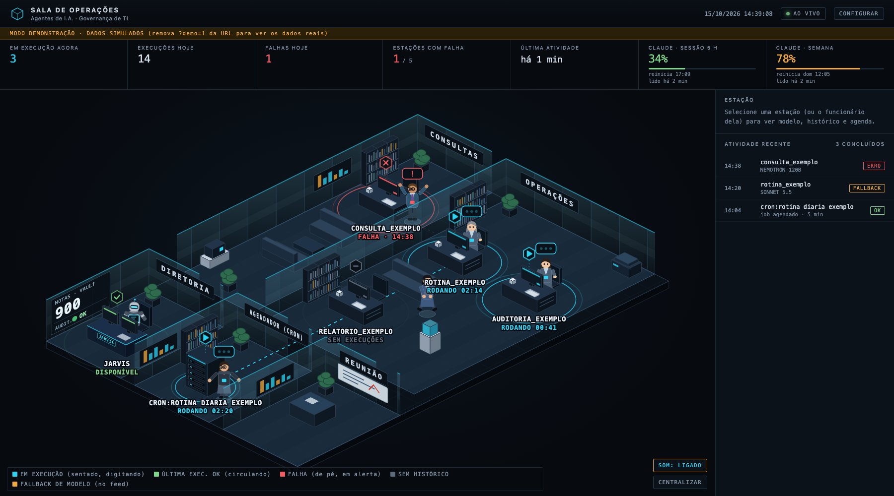
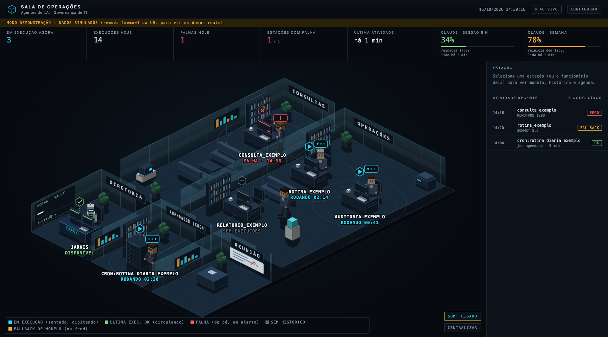

# Sala de Operações - Monitoramento de Agentes de I.A.

Painel local, em visão isométrica, que mostra o estado de agentes de I.A. do [Hermes](https://hermes-agent.nousresearch.com/docs), dos jobs agendados (cron) e, opcionalmente, da fila de chamados de uma equipe no Agidesk. Cada agente é um boneco numa sala; o estado real (rodando, ok, erro) define o que ele faz.



*Captura em modo demonstração (`?demo=1`), com agentes e números fictícios.*

- **Somente leitura e local:** o servidor escuta só em `127.0.0.1` (porta 8765 por padrão) e não grava nada além dos próprios arquivos de números em `~/.hermes/data/`.
- **Sem modelo de I.A. e sem gastar tokens:** o painel só lê arquivos de histórico, o banco de estado do Hermes e a API do Agidesk.
- **Privacidade:** o navegador recebe só nome do agente, hora, modelo e código de saída. O conteúdo das respostas nunca é enviado.
- **Equipe só no total:** a sala da equipe mostra os totais (em aberto, sem responsável, encerrados hoje), nunca nome ou número por pessoa: um placar individual exposto num painel pode constranger quem está nele.
- **Som de alerta (ligado por padrão):** botão SOM no canto do mapa, acima do CENTRALIZAR; desligar fica salvo no navegador. Toca uma vez quando um agente ou job falha, quando um agente fica 5 min sem ação ou quando uma fonte de dados dá problema, e um som suave quando volta ao normal. Regra do navegador: o áudio só sai depois do primeiro clique ou tecla na página (a página libera sozinha nesse momento; numa TV, abrir o Chrome com `--autoplay-policy=no-user-gesture-required` dispensa o clique). Com o som ligado, a página continua consultando mesmo com a aba escondida (a cada 10 s; o navegador pode espaçar para 1 min).
- **Só atende o próprio computador:** pedidos com outro nome de host recebem 403 (proteção contra *DNS rebinding*).
- **Só biblioteca padrão do Python 3.** Testado no macOS.

## Rodar

```
python3 server.py            # http://127.0.0.1:8765
python3 server.py 8800       # outra porta
```

Sem o Hermes instalado, o painel abre com os dados fictícios de `exemplo/` (`agentes.json`, `cron_jobs.json`). Acrescente `?demo=1` à URL para ver os estados de exemplo (rodando, erro, ocioso).

## Temas e preferências

Botão **CONFIGURAR** no cabeçalho (fica salvo no navegador; a URL tem prioridade e não grava):

| Opção | Valores | Na URL |
|---|---|---|
| Tema | Planta isométrica, **Modo TV** (sem painel lateral, números grandes e uma coluna "AGORA" com o que está rodando, falhou ou está sem ação, em letra grande), **3D** (a mesma planta em 3D de verdade) | `?tema=tv`, `?tema=3d` |
| Animação | completa, reduzida (15 quadros/s, sem pulsos), desligada (ninguém anda) | `?anim=reduzida` |
| Rótulos das estações | todos, nomes + rodando e falha (sem a linha "ÚLT."), só rodando e falha, nenhum | `?rotulos=ativos` |
| Som de alerta | ligado (padrão) ou desligado | |



O **tema 3D** (`?tema=3d`) é a mesma planta desenhada em 3D de verdade: mesmo ângulo, mesmos móveis, bonecos, cores e rótulos, com volume, luz e sombra. A planta continua sendo montada em SVG (rotas, rótulos, diagnóstico); durante a montagem cada ponto e cada caixa é anotado com a coordenada 3D, e uma câmera ortográfica no ângulo exato da planta desenha a cena por baixo dos rótulos. Usa [Three.js](https://threejs.org) r170, incluído em `web/vendor/three/` (licença MIT, ver o `LICENSE` da pasta): funciona sem internet e sem CDN. Sem WebGL, a página volta para a planta.

## Testar

```
python3 testar_sala.py            # ~6 min: dados atuais, demonstração, Modo TV, animação desligada, cenários fictícios (agente novo, cron com falha, equipe), lógica do som e o 3D
python3 testar_sala.py --rapido   # ~2 min
```

Precisa do Google Chrome (`CHROME=<caminho>` para outro local). Os cenários usam arquivos temporários; nada real é alterado. Os contadores do diagnóstico (`?debug=1`) devem ficar todos em 0. O teste também falha se algum nome ou número por pessoa da equipe chegar ao navegador.

## Configuração local (fora do repositório)

Os scripts que falam com sistemas reais leem os valores de `~/.hermes/data/sala_config.json` (ou do arquivo apontado por `$SALA_CONFIG`). Copie `config.exemplo.json` e preencha:

| Chave | Para quê |
|---|---|
| `agidesk_url` | URL base da API do Agidesk |
| `agidesk_keychain_account` / `agidesk_keychain_service` | item do Keychain (macOS) que guarda a chave de aplicação do Agidesk; lida só em memória |
| `equipe_id` | equipe cujos chamados a sala "GOVERNANÇA" mostra |
| `vault_path` | pasta do vault do Obsidian a contar (placa da DIRETORIA) |

Sem o arquivo, os scripts recusam rodar e dizem o que falta; nada é inventado.

## Arquivos

| Arquivo | Função |
|---|---|
| `server.py` | servidor HTTP local, montagem da planta e entrega da página (embute o CSS e os scripts de `web/` num documento só) |
| `index.html` | esqueleto da interface (cabeçalho, indicadores, painel lateral) |
| `web/js/` | o código da página, separado por assunto e carregado em ordem: `base`, `config` (temas e preferências), `planta`, `funcionarios`, `interface`, `diagnostico`, `som`, `planta3d` (tema 3D), `principal` |
| `web/css/sala.css` | estilos, inclusive Modo TV |
| `web/vendor/three/` | cópia do Three.js (MIT) usada pelo tema 3D |
| `layout.json` | em qual sala cada agente aparece (salas, prefixos, fluxos) |
| `equipe_agidesk.py` | job de cron (a cada 5 min): totais da equipe (em aberto, sem responsável, encerrados hoje); só GET, nada por pessoa |
| `vault_contagem.py` | job de cron: contagem de notas do vault para a placa da DIRETORIA |
| `claude_uso_poll.py` | opcional: percentual de uso do plano do Claude Code, lido com o token que o próprio Claude Code guarda |
| `sala_config.py` | leitura da configuração local |
| `testar_sala.py` | teste automático: abre a página no Chrome headless com `?debug=1` em vários cenários e falha se houver sobreposição, objeto atravessado, erro de JavaScript ou API incoerente |
| `exemplo/` | dados fictícios para rodar sem o Hermes |

Os jobs de cron são agendados no Hermes como jobs sem agente (`--no-agent`), apontando para os scripts acima.

## Licença

[MIT](LICENSE).
