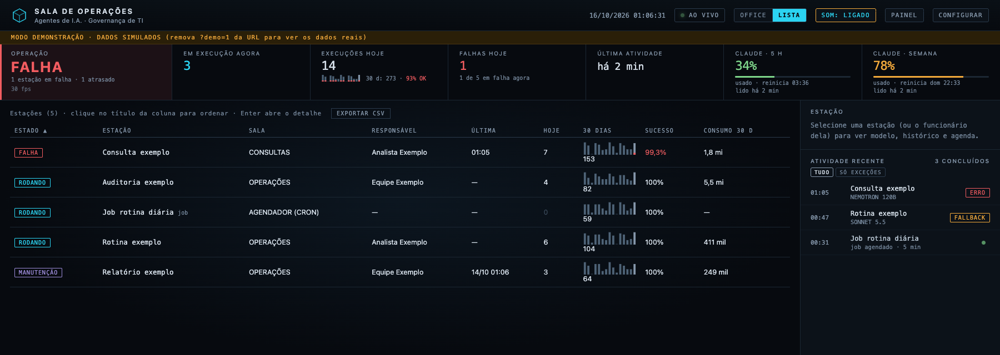

# Sala de Operações

🇧🇷 **Português** · 🇺🇸 [English](README.en.md)

**Veja seus agentes de I.A. trabalhando.** A Sala de Operações transforma agentes, rotinas agendadas e a fila da equipe num escritório vivo, em que cada agente é um funcionário com mesa própria. Quem está rodando aparece sentado, digitando. Quem falhou se levanta e pede ajuda. Basta olhar para saber como a operação está, sem abrir log nem terminal. Funciona com o **Hermes** e com o **Claude Code**.


<sub>Todas as capturas usam o modo demonstração, com agentes e números fictícios.</sub>

## Sumário

- [Cinco jeitos de ver a mesma operação](#cinco-jeitos-de-ver-a-mesma-operação)
  - [Planta](#planta-o-dia-a-dia) · [Modo TV](#modo-tv-para-a-parede-da-sala) · [3D](#3d-a-mesma-sala-com-volume) · [Pixel art](#pixel-art-a-mesma-sala-com-cara-de-jogo) · [Lista](#lista-tudo-numa-tabela)
- [O que você enxerga de relance](#o-que-você-enxerga-de-relance)
- [Destaques](#destaques)
- [Requisitos](#requisitos)
- [Comece em um minuto](#comece-em-um-minuto)
- [Com o Claude Code](#com-o-claude-code)
- [Personalize](#personalize)
- [Privacidade e segurança](#privacidade-e-segurança)
- [Qualidade](#qualidade)
- [Feito com](#feito-com)
- [Licença](#licença)

---

## Cinco jeitos de ver a mesma operação

### Planta: o dia a dia
A visão completa para quem acompanha de perto. Cada sala reúne um tipo de agente, e cada mesa mostra o nome do agente e o estado dele. Ao lado ficam o histórico de execuções, o modelo usado e a próxima rodada agendada. Clique numa mesa e veja os detalhes.

### Modo TV: para a parede da sala
Feito para ser lido de longe. Os indicadores ficam grandes, o painel lateral sai e a coluna **AGORA** mostra só o que importa no momento: o que falhou, o que está parado e o que está rodando. Quando está tudo bem, ela diz isso também.


### 3D: a mesma sala, com volume
A mesma planta, agora em 3D de verdade, com volume, luz e sombra. O ângulo, os móveis, as pessoas e os rótulos continuam no mesmo lugar, então a sala continua sendo a sua.


### Pixel art: a mesma sala, com cara de jogo
A mesma planta redesenhada em pixels, com contorno em cada móvel e funcionários desenhados à mão, com as mesmas roupas e os mesmos gestos. Os nomes e os estados continuam nítidos por cima. Aproxime uma sala (roda do mouse ou clique na placa) para ver cada pixel. Também existe em versão para a TV.


### Lista: tudo numa tabela
A chave **OFFICE | LISTA** troca a planta por uma tabela com todas as estações: estado, sala, responsável, última execução, execuções do período, índice de sucesso e consumo. Clique no título de uma coluna para ordenar e use **EXPORTAR CSV** para levar os números para a planilha. Uma estação em manutenção aparece em lilás e não dispara alarme.



---

## O que você enxerga de relance

| Na sala | Significa |
|---|---|
| Funcionário sentado digitando, selo ciano | o agente está rodando agora |
| Funcionário circulando, selo verde | a última execução terminou bem |
| Funcionário de pé com um **!**, selo vermelho | a última execução falhou |
| Balão com **?**, em âmbar | o agente está rodando, mas sem nenhuma ação há 5 minutos |
| Relógio âmbar, "ATRASADO HÁ…" | uma rotina deveria ter rodado e não rodou |
| Rack piscando na sala do agendador | uma rotina agendada está em execução, com a próxima rodada ao lado |

No topo, um veredito responde antes de tudo: **NORMAL**, **ATENÇÃO** ou **FALHA**. Ao lado ficam os números do dia, a tendência e o índice de sucesso do período (7 a 90 dias), a última atividade e, se você quiser, o consumo do plano do Claude.

## Destaques

- **Trabalho passando de mão em mão:** as estações de uma cadeia são ligadas por linhas que acendem quando a origem roda. Quando um agente da cadeia começa a rodar, o funcionário da etapa anterior leva uma pasta até a mesa dele: dá para ver a entrega de dados acontecer entre as salas.
- **O que ele está fazendo agora:** clique no funcionário de um agente e veja, ao vivo, a hora e o nome de cada ferramenta que ele usa. Só o nome da ferramenta: nada do que foi perguntado ou respondido.
- **O cérebro também tem mesa:** o Hermes principal é o Jarvis, um robô na Diretoria, que mostra **ATENDENDO VOCÊ** quando você está conversando com ele.
- **Painéis na parede:** o total de notas do seu vault do Obsidian (quantas entraram hoje e na semana, e o resultado da auditoria) e os totais da fila da equipe ficam pendurados nas salas, como num escritório de verdade.
- **Rotina atrasada não passa despercebida:** se um job agendado não disparou na hora (ou um agente passou do intervalo combinado sem rodar), a estação fica âmbar e o alarme avisa. Verde só quando está realmente em dia.
- **Alerta sonoro:** um som curto quando algo falha, trava ou atrasa, e outro mais suave quando volta ao normal. A sala continua de olho mesmo com a aba em segundo plano.
- **Atividade sem ruído:** execuções repetidas viram uma linha só ("×6 · desde 09:00"), o destaque fica só para o que fugiu do normal e um clique mostra **só as exceções**.
- **Tendência, sucesso e consumo:** execuções e falhas de 7, 15, 30, 60 ou 90 dias (você escolhe no CONFIGURAR) no topo e em cada estação, com o índice de sucesso (execuções OK ÷ execuções), a duração de cada execução e tokens e custo estimado por agente. A sala guarda o próprio histórico dos jobs, então o período longo vale também para eles.
- **Aviso por e-mail (opcional):** o vigia da sala, um script leve sem I.A., confere a operação a cada 5 minutos e manda um e-mail para um único endereço quando algo falha, trava, atrasa ou uma fonte de dados dá problema, e outro quando volta ao normal. No máximo um aviso de problema por estação a cada 30 minutos, para uma rotina instável não lotar a caixa de entrada. Só nomes, estados e horários. Se o próprio vigia parar, a sala avisa. Toda segunda-feira, às 8h, chega também um resumo da semana: índice de sucesso, falhas por estação, o que está atrasado ou em manutenção e o consumo por agente.
- **Manutenção sem alarme falso:** abriu uma janela de manutenção para uma estação? Ela fica lilás com **MANUTENÇÃO** até a data marcada, não dispara som nem e-mail, e o que roda dentro da janela fica fora do índice de sucesso.
- **Cada estação tem dono:** o responsável aparece no detalhe, na lista e na exportação.
- **Nada some sem aviso:** execução que morreu no meio do caminho, sem chegar ao fim, aparece como **INTERROMPIDA**. E se o script de um job ou o prompt de um agente sumir do disco, a sala avisa antes da próxima rodada falhar.
- **Escritório ou lista:** a chave OFFICE | LISTA no topo alterna entre a planta e as mesmas estações numa tabela ordenável por estado, sala, responsável, última execução, sucesso ou consumo (a visão ativa fica acesa), e o botão **EXPORTAR CSV** leva a tabela para o Excel. Bom para o celular e para achar uma estação rápido. SOM e CENTRALIZAR também ficam no topo, junto com os demais controles.
- **Fluidez à vista:** o card Operação mostra os quadros por segundo da animação, atualizados a cada segundo (o normal é a taxa da tela: 60 num monitor comum). Número bem abaixo disso indica que a página está pesada para aquela máquina.
- **Pelo teclado:** Tab percorre as estações, Enter abre o detalhe e Esc fecha. As estações têm descrição para leitor de tela.
- **Do seu jeito:** pelo menu **CONFIGURAR** você escolhe o tema, a intensidade da animação, quais rótulos aparecem e se as estações mostram nomes amigáveis ("Consulta AD") ou o id técnico.
- **A equipe no mesmo lugar (opcional):** chamados em aberto, sem responsável, vencidos e encerrados no Agidesk, e o tempo de atendimento da semana, sempre como total da equipe. Ninguém vira placar individual.
- **Organiza-se sozinha:** agente novo ganha mesa automaticamente, e as salas crescem conforme a operação cresce.
- **Leve:** um servidor em Python puro e uma página no navegador. Nada de banco de dados, build ou dependências para instalar.
- **Qualquer tela:** do monitor ultrawide ao notebook (o painel lateral recolhe com um clique) e ao celular.

## Requisitos

| Para | Precisa de |
|---|---|
| Rodar a sala | **Python 3.9 ou mais novo** (testada no 3.9 e no 3.14; só a biblioteca padrão, nada para instalar com pip) |
| Ver a sala | um navegador atual. Testada no **Google Chrome**; Edge usa o mesmo motor. O tema 3D precisa de WebGL, que os navegadores atuais já trazem ligado |
| Dados de verdade | o **[Hermes](https://hermes-agent.nousresearch.com/docs)** ou o **[Claude Code](https://code.claude.com/docs)** na mesma máquina (ou qualquer comando, [pelo embrulho](#com-o-claude-code)). Sem nenhum deles, a sala abre com agentes de exemplo |
| Consumo do Claude no topo (opcional) | o **Claude Code** com login por assinatura (Pro ou Max) |
| Fila da equipe (opcional) | uma conta no **Agidesk** com chave de API, guardada no Keychain do macOS |
| Aviso por e-mail (opcional) | o **[himalaya](https://github.com/pimalaya/himalaya)** com uma conta de envio configurada |
| Rodar os testes | o **Google Chrome** (o teste abre a página num Chrome invisível) |

Testada no macOS. O servidor é Python puro e deve rodar também em Linux e Windows, mas as integrações opcionais (Keychain) são do macOS.

## Comece em um minuto

```bash
git clone https://github.com/ToninhoRK/tRK-sala_de_operacoes.git
cd tRK-sala_de_operacoes
python3 server.py
```

Abra **http://127.0.0.1:8765** no navegador. Para ver todos os estados em ação, use **http://127.0.0.1:8765/?demo=1**.

Com o [Hermes](https://hermes-agent.nousresearch.com/docs) instalado, os agentes e as rotinas dele aparecem sozinhos. Sem ele, a sala abre com os agentes de exemplo da pasta `exemplo/`.

Para deixar a sala sempre no ar no Mac, com o vigia a cada 5 minutos, rode `python3 agendar_mac.py`: ele cria e liga os dois agendamentos com os caminhos certos (`--simular` mostra antes, `--remover` desfaz).

## Com o Claude Code

A sala também acompanha agentes do **Claude Code** rodando sem tela (`claude -p`), chamados à mão ou por qualquer agendador (cron, launchd, Agendador de Tarefas). O `registrar_execucao.py` roda o comando e registra início, fim e resultado. A resposta aparece no terminal e nunca é gravada.

1. Cadastre o agente no catálogo `~/.hermes/scripts/agentes.json` (o nome da pasta vem do Hermes, mas ele não precisa estar instalado):

```json
{"resumo_diario": {"descricao": "Resume os chamados abertos do dia", "modelo": "claude-sonnet", "cadencia_h": 24}}
```

2. Rode o agente pelo embrulho. Nome fora do catálogo é recusado (código 2) sem rodar nada, para um erro de digitação não virar execuções que a sala nunca mostra:

```bash
python3 registrar_execucao.py resumo_diario --modelo claude-sonnet -- claude -p "Resuma os chamados abertos hoje"
```

3. Opcional, para ver o consumo do plano no topo: em `~/.claude/settings.json`, aponte a barra de status do Claude Code para o `claude_statusline.py` da sala. Ela passa a mostrar o uso da sessão de 5 h e da semana, e a sala lê o mesmo número (só o percentual e a hora de reinício são gravados).

```json
{"statusLine": {"type": "command", "command": "python3 /caminho/da/sala/claude_statusline.py"}}
```

Sem o Hermes, funcionam igual: estação, estado, histórico, duração, falhas, execuções interrompidas, atraso (pela `cadencia_h`), pasta entre salas e consumo do plano. Ficam de fora o quadro do que o agente está fazendo agora, o aviso de "sem ação", tokens e custo por agente, o Jarvis e a sala do agendador, que lê as rotinas do Hermes (rotinas do cron entram como agentes, com o atraso pela `cadencia_h`).

**Usa outro orquestrador?** A sala só lê alguns arquivos simples (catálogo em JSON e uma linha de log por execução). O [formato de entrada](docs/FORMATO.md) explica cada um; o mesmo `registrar_execucao.py` transforma qualquer comando num agente da sala.

## Personalize

- **Salas e agentes:** em `layout.json` você define as salas e quem senta em cada uma, por nome ou por prefixo (por exemplo, todo `consulta_*` vai para CONSULTAS), e os nomes amigáveis de cada estação.
- **Rotinas com prazo:** os jobs agendados já trazem a própria agenda. Para um agente que deve rodar com certa frequência, acrescente `"cadencia_h": 24` na entrada dele (e `"cadencia_dias_uteis": true` para não contar o fim de semana): passou de 1,2× esse intervalo sem rodar, ele aparece como atrasado.
- **Integrações:** a fila da equipe no Agidesk e a contagem de notas de um vault do Obsidian são configuradas num arquivo local (veja `config.exemplo.json`). A chave de acesso fica no Keychain do macOS, nunca no código.
- **Responsável:** `"responsavel_padrao"` no arquivo local de configuração vale para todas as estações; `"responsavel"` na entrada de um agente no `agentes.json` vale só para ele.
- **Janela de manutenção:** pelo `manutencao.py` (a estação é o nome do agente ou `cron:<nome do job>`):

```bash
python3 manutencao.py iniciar rateio_mensal --ate +2d --motivo "troca de senha"
python3 manutencao.py listar
python3 manutencao.py encerrar rateio_mensal
```

- **Vigia (aviso por e-mail e histórico longo dos jobs):** agende `python3 vigia_sala.py` a cada 5 minutos: no Mac, `python3 agendar_mac.py` já faz isso; no Linux, cron; no Windows, Agendador de Tarefas. Sem a chave `alerta_email` na configuração, ele só guarda o histórico; com ela, avisa um único endereço. A primeira rodada só anota como as coisas estão, sem e-mail.
- **Para uma TV:** abra `/?tema=tv` (ou `/?tema=pixeltv`, em pixel art) em tela cheia; `&sala=<id da sala>` abre já aproximado numa sala. Se a TV não tiver teclado nem mouse, inicie o Chrome com `--autoplay-policy=no-user-gesture-required` para o som tocar sem precisar de clique.

## Privacidade e segurança

- **Roda só no seu computador:** o servidor só aceita conexões do próprio computador (`127.0.0.1`).
- **Sites de fora não leem a sala:** pedidos com endereço diferente de `127.0.0.1` ou `localhost` são recusados, então uma página maliciosa aberta no navegador não consegue ler os dados da sala.
- **Somente leitura:** a sala só observa os agentes, nunca dispara nem altera nada. O vigia opcional só grava o histórico da própria sala e manda o e-mail de aviso.
- **Zero tokens:** a sala não usa modelo de I.A. e só lê históricos e arquivos de estado.
- **O conteúdo fica onde está:** o navegador recebe nome do agente, horário, modelo e resultado. Perguntas e respostas dos agentes nunca saem do lugar onde estão.

## Qualidade

Dois níveis de teste acompanham o projeto:

- `python3 testes_servidor.py`: em cerca de um segundo, confere a lógica do servidor com dados fictícios (estados, atraso, início e fim de execução, o embrulho `registrar_execucao.py`, período e índice de sucesso, manutenção, o vigia com um envio de e-mail falso, consumo, privacidade da equipe e as travas de segurança). Roda também no GitHub a cada envio, em Python 3.9 e 3.13.
- `python3 testar_sala.py`: abre a página num navegador em vários cenários (dados reais, demonstração, Modo TV, 3D, pixel art, a pasta entre salas, atrasos, agentes novos e falhas) e reprova qualquer rótulo sobreposto, objeto fora do lugar, erro de script ou dado individual da equipe.
- `python3 .github/checar_readmes.py`: confere que este README e a versão em inglês têm as mesmas seções, capturas, tabelas e links. Roda no GitHub a cada envio, para as duas versões nunca ficarem diferentes.

## Feito com

Python 3 (só a biblioteca padrão), HTML, CSS e SVG sem frameworks, e [Three.js](https://threejs.org) para o 3D, incluído no projeto para funcionar sem internet.

## Licença

[MIT](LICENSE). Use, adapte e monte a sala da sua operação.
